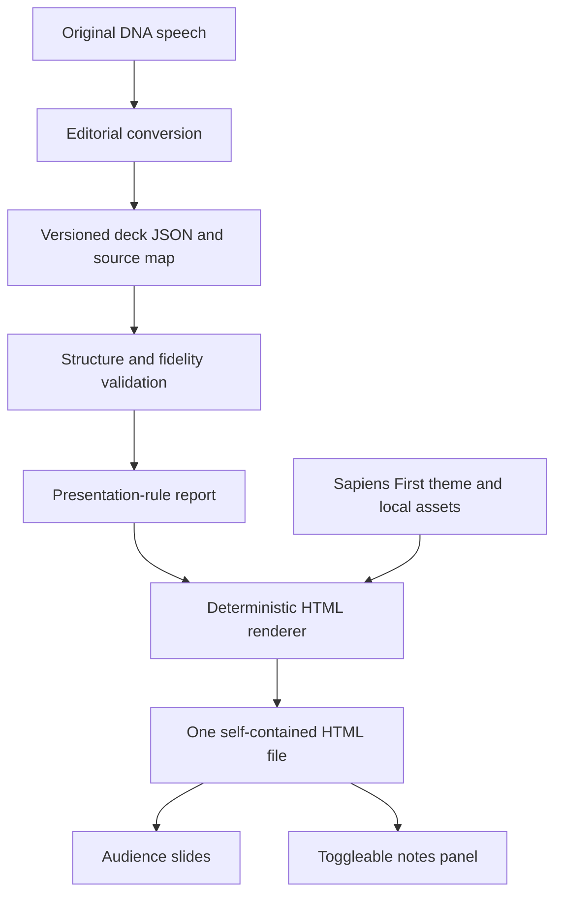
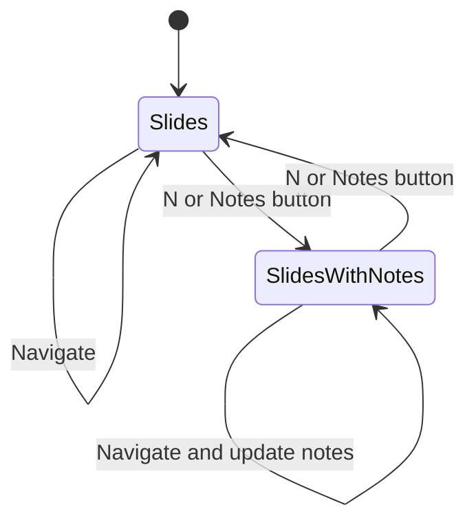

# One-file Sapiens First DNA slide renderer

## Goal Capsule

- **Objective:** Give a speaker a clear, recognizably Sapiens First presentation of the DNA draft, while retaining the words needed to deliver it.
- **Means:** An editorial conversion from speech to versioned JSON, followed by a small deterministic Node renderer with inline CSS, JavaScript, and Sapiens First assets.
- **First experiment:** One isolated, ten-slide presentation sourced exclusively from `10-2 content additions/10-6-dna`.
- **Authority:** This document plans the work. Claude can execute its six stages when given the implementation handoff; publishing and handbook integration are subsequent work.
- **Finished result:** Editable deck JSON, a reusable rendering command, one self-contained HTML file, toggleable speaker notes, and evidence from presenting the DNA deck. Double-click the HTML to present; share that file alone. No installation, server, or internet is required.

---

## Product Contract

### Summary

Convert the DNA speech into a compact visual argument and render it as one self-contained HTML slideshow in the existing brand. Preserve the complete source and map its passages to speaker notes, so reducing slide text does not discard the talk.

### Problem Frame

The source is approximately 1,097 whitespace-delimited words, arranged as an introduction, story, strategy, culture, structure, and pathways to action. Turning each paragraph into a slide would produce an overcrowded deck. Copying only highlights would lose the speaker's explanation.

The user clarified that simplicity and one-file delivery matter. The audience receives one HTML file containing all styles, scripts, diagrams, fonts, and notes. Editable authoring files enable rebuilding but are not required to view or share the deck.

The useful separation is between what the audience sees and what the speaker says. The editorial stage chooses the argument, sequencing, and visual form. The rendering stage produces the same HTML from the same structured content without making editorial decisions.

The repository already supplies the visual vocabulary and Node tooling. Its published handbook is built with VitePress; its operational plans belong in `maintenance/`. This experiment should have its own source and output directory outside `docs/`.

### Requirements

| ID | Requirement | Origin |
| --- | --- | --- |
| R1 | Use `10-2 content additions/10-6-dna` as the first deck's sole speech source. Preserve its original file. | User |
| R2 | Make source-to-slide conversion explicit and reviewable in a structured, editable format before rendering. | User |
| R3 | Provide a reusable tool that renders that format to HTML; deck content must not be hardcoded in the renderer. | User |
| R4 | Match the design vocabulary of the current docs and `sapiensfirst.org`. | User |
| R5 | Preserve source passages as slide-associated speaker notes. Retain the complete original source with the structured deck. | User, fidelity interpretation |
| R6 | Apply 10-20-30, 1-6-6, 5-5-5, and 3E as closely as practical, with measurable checks and explicit exceptions. | User and linked article |
| R7 | First validate an isolated DNA slideshow, with separate implementation stages suitable for Claude. | User |
| R9 | Deliver one self-contained HTML file that opens directly in a browser and works offline with no accompanying assets or server. | User clarification |
| R8 | Do not fill missing content, import policies from other documents, or turn source claims into stronger claims. | Fidelity constraint |

### Audience and Flows

Assume a newcomer attending a live introduction to Sapiens First. The speaker explains the nuance; the audience sees a few memorable ideas and their relationships. This audience assumption can be revised during the first content review without changing the renderer.

1. **Author:** Read the source, choose a narrative, create deck JSON, inspect source coverage and presentation-rule findings.
2. **Builder:** Validate the JSON, generate one self-contained HTML file, and open it directly.
3. **Speaker:** Navigate slides, toggle the current slide's source notes and editorial cues, and rehearse the planned timings.
4. **Reviewer:** Check the rendered slides, content fidelity, pacing, and brand fit; edit JSON and rebuild.

### Scope Boundaries

The experiment consists of one deck and a small renderer that can accept another deck in the same format. Source interpretation is performed by Claude or a person in an editorial pass. The tool itself does not call a language model.

**Considered and not built:** Reveal.js or another slideshow dependency, a local server, browser editor, separate presenter-window synchronization, model-provider integration, image-generation pipeline, plugin framework, and arbitrary HTML authoring. A small inline browser runtime covers the required navigation and notes toggle. JSON covers authoring.

**Deferred to follow-up work:** Hosted automatic speech conversion, VitePress integration, publishing, a deck library, PPTX export, and a private presenter window. Single-file HTML is the initial deliverable.

### Acceptance Examples

- AE1. The DNA JSON renders ten slides. The Act–Recruit–Train slide shows a cycle; its speaker notes retain the source's explanation of momentum-driven organizing.
- AE2. A speaker double-clicks the HTML and presses N or the Notes button. A panel displays the current slide's notes, updates on navigation, and closes to restore the clean audience view.
- AE3. Changing a valid slide label in JSON changes the rebuilt HTML without modifying renderer code. Invalid content produces a slide-specific diagnostic.
- AE4. The source's empty Culture section remains an author-visible gap. The deck introduces no invented Culture teaching or replacement policy.
- AE5. Copying only the generated HTML into a fresh directory and opening it over file:// with internet disabled preserves slides, fonts, logo, diagrams, navigation, and notes.

---

## Planning Contract

### Grounding and Design Direction

Verified local references:

- `docs/.vitepress/theme/style.css`: brand tokens, Barlow Condensed display type, DM Sans body type, coral chips, marker underlines, ink borders, and hard shadows.
- `docs/.vitepress/theme/home.css`: chapter-map hierarchy, boxed numbers, and generous paper spacing.
- `docs/.vitepress/config.mts`: current font families and logo reference.
- `docs/public/logo.png`: existing brand asset.
- `STYLE-GUIDE.md`: lead with the point, group ideas when useful, preserve genuine four-step sequences, and use editable SVG for diagrams.
- `scripts/build-book.mjs`: adjacent Node ESM export pattern and existing Playwright-based browser tooling. Borrow conventions rather than extending the book exporter.
- `scripts/handbook-integration.test.mjs`: existing `node:test` and temporary-fixture conventions.
- `README.md`: `docs/` is published content; `maintenance/` holds plans. There is no existing slide renderer or Reveal.js dependency in `package.json`.

The public homepage and `https://sapiensfirst.org/shared.css` were fetched on October 6, 2026. Their core paper, ink, coral, yellow, Barlow Condensed, and DM Sans tokens match the docs. The homepage also uses oversized uppercase claims, dark crisis panels, colored groups, and marker highlights. This is source/CSS grounding; visual browser comparison is still an implementation-stage check.

| Element | Initial slide treatment |
| --- | --- |
| Paper | `#f8f3eb`; secondary surface `#f0e8dc` |
| Ink | `#111111`; dark slides use white or paper text |
| Accents | Coral `#ff7870`, yellow `#ffd60a`, sky `#bcd8ff` |
| Display type | Barlow Condensed, primarily weight 800; uppercase short claims |
| Body type | DM Sans; sentence case; avoid paragraphs on slides |
| Shapes | Rectangular panels, 2px ink borders, 4–6px hard offset shadows |
| Emphasis | One restrained marker underline or tilted chip per composition |
| Layout | 16:9; 1280 × 720 logical canvas; generous margins and one dominant idea |

Use the loud brand elements for opening, crisis, and closing slides. Use calmer paper compositions for explanatory diagrams. Do not copy the website's navigation or full page layouts into slides. Avoid generic gradient backgrounds, rounded SaaS cards, stock illustrations, and ornamental charts. Diagrams should explain the actual organizing relationships.

### Key Technical Decisions

- KTD1. **Use versioned JSON as the authoring boundary.** The repository already uses JSON for handbook data. Explicit layout fields are easier to inspect and validate than ad hoc Markdown delimiters, and leave less ambiguity for an agent. Keep the format small; no YAML parser or Markdown slide parser is required.
- KTD2. **Use a minimal inline browser runtime.** It manages active slide index and notes-panel visibility. Arrow keys, Page Up/Down, Space/Shift-Space, Home/End, and visible previous/next controls suffice; stop at the ends. N and a Notes button toggle notes. No framework, autoplay, animation, separate presenter window, or synchronization.
- KTD3. **Generate one self-contained file using Node ESM without new dependencies.** Render slides and notes at build time, inline theme CSS/runtime JS, embed font bytes and logo as data URIs, and generate trusted inline SVG diagrams. Include font licenses. No browser fetches or external resource references. Authoring may use multiple files; the viewer needs only the HTML.
- KTD4. **Retain source text and reference notes by line range.** Store the full source snapshot and its SHA-256 digest in the deck. Each slide identifies the original, inclusive, one-based line ranges it speaks to. Derive notes from those ranges; keep additional cues separate and labelled. This prevents summaries from masquerading as the original speaker's words.
- KTD5. **Use six layouts with bounded content.** Start with `statement`, `triad`, `cycle`, `question`, `steps`, and `roles`. They all have a title and may have one optional section label. Only the layouts actually needed by this DNA deck are implemented. Closing actions reuse `triad`; the roadmap and engagement path reuse `steps`.
- KTD6. **Validate structure, fidelity, and slide rules separately.** Structural failures stop generation. Presentation-rule failures return actionable findings and fail the strict check used for the DNA acceptance deck. The renderer never silently truncates content, shrinks fonts, rewrites words, or inserts slides.
- KTD7. **Keep the experiment small and outside handbook publishing.** Authoring/tool files live in `experiments/slides/`; generated `output/10-6-dna.html` is ignored. Use a direct Node command rather than changing package dependencies, sidebar, or deployment.

### High-Level Technical Design



The CLI has two operations: validate an input deck and build it to a specified HTML path. The convenience build uses the DNA deck. There is no preview server: double-click the output. The authoring tool should stay compact; consolidate validation/rendering/CLI in `experiments/slides/slides.mjs` unless an actual readability need justifies splitting.

Notes start hidden, update with slide navigation, and scroll in a panel without obscuring controls. Showing them displays them in the same window; a private presenter screen is deferred. Notes remain in HTML, so visibility is not confidentiality. Keyboard shortcuts respect editable controls and browser modifiers; buttons have visible focus and state labels.



### Structured Format

This is a directional grammar, not implementation code. U1 resolves exact field names and records them in the experiment README before layout work starts.

```text
Deck
  schemaVersion: 1
  id, title
  targetDurationSeconds: 840
  source: path, sha256, full original text
  sourceGaps: heading, explanation, line range
  slides: ordered Slide[]

Slide
  id: stable unique identifier
  layout: statement | triad | cycle | question | steps | roles
  purpose: explain | engage | empower
  role: content | buffer
  title: short audience-facing text
  sectionLabel?: short audience-facing text
  content: fields specific to the selected layout
  durationSeconds: positive integer
  notes:
    sourceRanges: inclusive original line ranges
    cues?: separately labelled editorial prompts
  ruleExceptions?: rule, reason, affected text
```

For `triad` and `cycle`, content is exactly three short labels. For `steps`, it is three or four ordered labels, optionally with one shared outcome caption. For `roles`, it is one circle label and two or three role labels, plus at most one short ownership caption. For `statement`, it is at most two short supporting lines. `question` needs only its title.

Do not accept arbitrary HTML, user-supplied SVG, remote asset URLs, or executable expressions in content. Render labels as escaped text. Build any diagrams from trusted layout primitives with semantic text and accessible descriptions. This restriction keeps the renderer predictable rather than creating a new template language.

Source ranges must cover all substantive source paragraphs in their original order across the deck. Headings, agenda navigation, and the empty Culture heading may be classified explicitly in the coverage report rather than spoken literally. No substantive passage can be classified away to satisfy the timing or text rules. The full snapshot preserves every character regardless of classification. Prefer nonoverlapping ranges; note any intentional duplication.

Rebuilding against a changed source digest should request an explicit source-map refresh rather than silently producing stale notes. That update belongs to the editorial workflow, because old line ranges can remain valid numbers while referring to the wrong passage.

### Applying the Presentation Rules

Use the definitions from the [Smallppt article supplied by the user](https://smallppt.com/blog/basics/detailed-presentation-guidance:-the-different-presentation-rules). Its initial 3E definition is explain, engage, empower; later wording differs. Use the initial definition as the deck's purpose vocabulary. These are design heuristics, not evidence that a presentation is effective.

| Rule | DNA target | Check |
| --- | --- | --- |
| 10-20-30 | Ten slides; a planned 14 minutes; principal text at least 30pt | Slide count; summed timings ≤1,200 seconds; principal text ≥40 CSS px at the logical canvas |
| 1-6-6 | One core idea; at most six authored text lines; at most six words per line | Count title, section label, captions, and diagram labels; verify actual wrapping in the browser |
| 5-5-5 | At most five points; at most five words per point; no more than five consecutive content slides | Label/point counts and word counts; slide 6 is a question buffer |
| 3E | Each slide explains, engages, or empowers | Required purpose enum plus human review of whether the content earns it |

Apply the tighter five-word cap to points/labels; titles may use six words. A buffer still counts toward the ten-slide limit. Notes, presenter cues, navigation controls, and slide numbers are outside audience-content text budgets. Do not use a small footnote to conceal substantive content.

For triads, the title and three labels use four authored lines; details belong in notes. For diagrams, every text label consumes budget. Define a word as a whitespace-delimited token after trimming; hyphenated terms count as one token. This deliberately simple convention is documented and consistent.

The 30pt rule maps to 40 CSS px before the canvas scales to fit the viewport. At a 1280 × 720 presentation viewport, verify effective sizes; on smaller viewports report scaling rather than claiming a physically identical point size. Full-screen projection is the primary use. Narrow-screen inspection should retain access to navigation and notes without content disappearing.

Actual line wrapping and clipping require browser checks after local fonts load. Six strings in JSON do not prove six rendered lines. If a label wraps or a diagram is cramped, revise the wording or layout rather than shrinking the type. Rehearsal tests the duration; a sum of intended timings does not measure speaking time.

### Assumptions and Content Gaps

- **Audience and duration:** Newcomer orientation, with 840 planned seconds including discussion pauses. The source alone would take roughly 8.4 minutes at an assumed 130 words per minute; transitions and the question make the 14-minute budget plausible, subject to rehearsal.
- **Conversion:** Claude performs the first editorial conversion. Automating that reasoning with a provider API is deferred; the reusable renderer and format are built now.
- **Culture:** `## Part 3: Culture` has no body. Keep it in `sourceGaps` and author review; omit a standalone Culture teaching slide. The structure slide may discuss the autonomy/unity language actually present in the source, without labelling it a complete set of movement values.
- **Claims:** The draft includes empirical and numerical claims, including the 3.5% statement, AI examples, and donation/dues amounts. Preserve them in source notes, record their review needs, and do not add website statistics or stronger assertions to audience slides. Content verification for publication is separate from this local rendering experiment.
- **Terminology:** Use the draft's Supporters, Members, Organizers, Roles, and Circles. The current handbook and tech-team notes provide design/tooling context, not permission to replace the speech's terminology.
- **Fonts:** Embed the required font bytes and license notices in the generated HTML during implementation. The exact files and browser executable are implementation details to resolve and verify; neither is claimed to exist locally today.

### Proposed DNA Slide Storyboard

This is the initial editorial proposal. U1 turns it into complete JSON and exact notes ranges. Headlines paraphrase the source; they are not purported verbatim quotations.

| # | Audience copy | Layout / purpose | Visual idea and notes coverage | Seconds |
| --- | --- | --- | --- | --- |
| 1 | **Fight for a brighter future** | statement / engage | Oversized paper-and-ink opener with coral emphasis. Notes: first introduction paragraph and the four-part agenda. | 45 |
| 2 | **Technology needs political change**; “A remedy”; “A poison” | statement / explain | Two opposing text treatments with ample space, one central tension. Notes: agriculture, industry, and the digital-age examples before the AI paragraph. | 75 |
| 3 | **Unchecked AI threatens our future**; “Inequality”; “Threats to democracy”; “Human extinction” | triad / explain | A dark crisis panel with three plain labels. Notes: the AI/power paragraph and all three crisis explanations. Preserve the source's conditional framing. | 90 |
| 4 | **Life. Liberty. Happiness.**; “Human survival”; “Democratic power”; “Shared prosperity” | triad / explain | Three accent panels; no descriptions on the cards. Notes: the complete Vision passage, including treaties, democratic reform, and wealth distribution. | 90 |
| 5 | **Build momentum together**; “Act”; “Recruit”; “Train” | cycle / explain | Three nodes and a returning arrow. Notes: cohesive strategy, structure-based organizing, mass mobilization, and the Act–Recruit–Train explanation. | 90 |
| 6 | **What could your chapter do?** | question / engage; buffer | One large question on yellow; deliberate audience pause. Notes: concluding strategy/3.5% paragraph, then a separately labelled facilitator cue linking the question to local action. | 60 |
| 7 | **Build toward federal action**; “Seed cities”; “California”; “Red and blue states”; “Federal policy change” | steps / explain | Four numbered steps and the shared outcome caption “Federal legislation for an AI treaty”. Notes: the complete Roadmap, including local campaigns, tactics, and chapter experimentation. | 105 |
| 8 | **Grow through participation**; “Supporter”; “Member”; “Organizer” | steps / explain | Three stages with directional arrows. Notes: volunteer scaling and the full engagement path, including email, dues, Discord, and active roles. | 75 |
| 9 | **Own a role. Build together.**; “Media Circle”; “Social Media Manager”; “Email Sender”; “Clear rules. Clear ownership.” | roles / explain | Two role boxes inside a circle boundary, with the ownership caption. Notes: full Holacracy, autonomy/unity, rules-of-the-road, ownership, and role/circle passages. Author-visible Culture gap remains recorded separately. | 120 |
| 10 | **Choose your next step**; “Donate”; “Join”; “Organize” | triad / empower | Large closing action panel in the brand palette. Notes: complete Pathways to Action, including amounts, solidarity dues, and leadership development. Do not invent links or a QR code. | 90 |

Total: 840 seconds / 14 minutes. Slide 7 uses all six authored lines (title, four step labels, outcome caption), so omit an additional section label. The question interrupts the content run after five slides. Slides 7–10 form a four-slide closing run. Culture remains a gap rather than becoming slide 11. Multiple values on a triad slide serve one umbrella idea; a reviewer must confirm they do not become three unrelated arguments.

### Output Structure

```text
experiments/slides/
  README.md
  slides.mjs               validation, notes, CLI, layouts, inline CSS/JS
  decks/
    10-6-dna.deck.json
  fonts/                   build inputs and licenses
  tests/
    slides.test.mjs
    browser.mjs
  output/                  generated and ignored
    10-6-dna.html           sole presentation deliverable
```

Authoring files are used only for rebuilding; presenting or sharing requires just `10-6-dna.html`. The exact module split may be simplified if it removes needless indirection. Six layouts do not require six modules or a plugin registry. Every module must serve the DNA build or its verification.

---

## Implementation Units

Execute sequentially for the first test. Each stage has explicit file ownership so it can be handed to a fresh Claude session. Preserve the untracked source file and accommodate other workspace changes; do not revert others' edits. A checkpoint is a reviewable output, not an additional permission requirement.

### U1. Convert the source and settle the deck format

**Goal:** Establish what the audience sees and what the speaker retains before building layout code.

**Requirements:** R1, R2, R5, R6, R8; AE4. **Dependencies:** None.

**Owned files:** `experiments/slides/decks/10-6-dna.deck.json`, format/editorial portions of `experiments/slides/README.md`.

**Approach:** Apply KTD1, KTD4, and the storyboard. Produce the complete source snapshot, real digest, precise ranges, timings, purposes, and audience text for all ten slides. Record gaps, paraphrases, any duplicated ranges, and passages kept only in notes. Verify the diagram relationships against the speech. Keep the Culture gap and claim-review needs explicit.

**Patterns:** `STYLE-GUIDE.md`; the source's own section sequence. The tech-team documents are context only.

**Test expectation:** No test code for the editorial document. Check every substantive paragraph against its assigned notes range and read the audience copy aloud. Validator coverage belongs to U2.

**Checkpoint:** Deck JSON, a source-to-slide coverage table, and a concise explanation of why this story fits ten slides. Content approval can refine the storyboard without blocking foundational tool work.

### U2. Implement validation and faithful notes assembly

**Goal:** Make malformed or lossy decks visible before rendering.

**Requirements:** R2, R3, R5, R6, R8; AE3, AE4. **Dependencies:** U1.

**Owned files:** validation/notes portions of `experiments/slides/slides.mjs`, `experiments/slides/tests/slides.test.mjs`, validation portions of `experiments/slides/README.md`.

**Approach:** Validate the documented version and layout fields without a general-purpose schema framework. Resolve source ranges from the snapshot, label cues separately, and report coverage. Apply KTD6 with slide IDs in diagnostics. Distinguish a registered source gap from missing substantive text. Validate the original-source digest when that file is available in the authoring workspace; the generated HTML never depends on that path.

**Test scenarios:**

1. The real DNA deck passes structural and source-coverage checks, including its registered Culture gap.
2. Invalid JSON, an unsupported version/layout, duplicate slide IDs, or out-of-bounds ranges fail with useful diagnostics.
3. An omitted substantive source paragraph is reported even though the complete source snapshot still exists.
4. Source notes reproduce selected text exactly; cues appear as editorial additions.
5. A changed source file invalidates its old mapping; deliberate refresh restores consistency.
6. Six-word point text, eleven slides, more than five consecutive content slides, or a duration exceeding twenty minutes produces the appropriate rule finding.
7. Titles, section labels, captions, and diagram labels participate in authored line/word budgets; long notes do not.

**Checkpoint:** A validation report for the DNA deck showing complete source coverage and any explicitly justified rule exceptions.

### U3. Build the HTML rendering tool and presentation shell

**Goal:** Turn the validated data into navigable HTML with working presenter notes.

**Requirements:** R3, R5, R7, R9; AE1, AE2, AE3, AE5. **Dependencies:** U2.

**Owned files:** Rendering/runtime/CLI portions of `experiments/slides/slides.mjs`, generation tests in `experiments/slides/tests/slides.test.mjs`, `.gitignore` entry for output.

**Approach:** Apply KTD2, KTD3, KTD5, and KTD7. Implement six trusted templates, original notes and labelled cues, inline styles/scripts, validate/build operations, and defined controls. No runtime reads or network calls. The HTML must open directly. Styling and embedded font/logo inputs are completed in U4.

**Patterns:** Node ESM and `node:test` from existing scripts. Do not extend `scripts/build-book.mjs` or import the VitePress theme wholesale.

**Test scenarios:**

1. Building the DNA deck generates ten slides, the six required layout forms, and source notes associated with the right slide IDs.
2. Rebuilding identical content produces identical content files; avoid volatile timestamps in generated HTML.
3. A changed valid JSON label appears in the next build without renderer changes.
4. Text containing angle brackets, ampersands, quotes, or a script-closing sequence is displayed as text in both slides and notes; it cannot execute.
5. The generated HTML contains every runtime resource inline, with no supporting-file dependency.
6. Invalid input does not replace a usable existing output with a half-built presentation; validate before writing.
7. Source text is rendered at build time; opening the HTML does not fetch JSON, assets, or the original speech.

**Checkpoint:** A working local HTML deck and a minimal README explaining how to validate, build, open the HTML directly, navigate, and toggle notes. The plain shell is expected to gain final styling in U4.

### U4. Apply the Sapiens First theme and refine diagrams

**Goal:** Make the slideshow visually coherent and legible in the existing brand.

**Requirements:** R4, R6, R9; AE1, AE5. **Dependencies:** U3.

**Owned files:** Inline theme/layout portions of `experiments/slides/slides.mjs`, `experiments/slides/fonts/`, presentation examples in the README.

**Approach:** Use the verified tokens and compositions above. Embed font bytes/license notices and the existing logo in the HTML, and size all meaningful audience text to the presentation minimum. Keep all diagram text real and accessible; no screenshots of text. Use restrained or no transitions and respect reduced-motion preferences.

**Test expectation:** Styling changes need visual/browser evidence rather than CSS-value snapshot tests. Inspect the opener, dark crisis triad, cycle, four-stage roadmap, nested roles, and closing slide at 1280 × 720 and 1920 × 1080 after fonts load. Also inspect a narrow viewport for access and clipping. The browser checks are owned by U5.

**Checkpoint:** Screenshots of all ten slides and a short comparison with the docs/public-site references. Amend audience copy in collaboration with U1's content artifact if space is tight; do not let CSS hide or shrink the problem.

### U5. Verify the complete deck in the browser and in rehearsal

**Goal:** Show that the actual HTML satisfies the presentation contract.

**Requirements:** R3–R7, R9; AE1–AE5. **Dependencies:** U3, U4.

**Owned files:** `experiments/slides/tests/browser.mjs`, verification portions of `experiments/slides/README.md`, fixes in the experiment files as demonstrated by checks.

**Approach:** Use the existing `playwright-core` installation with a documented Chromium executable. Open the output directly over file:// without a server. Copy only that file to a fresh directory and disable networking. Inspect actual rendered geometry after embedded fonts resolve. Capture screenshots for human review; automated geometry does not establish brand fit or persuasion. Rehearse the source notes with transitions and the question pause. Record observed duration; shorten cues or reduce pauses if needed without deleting the original source.

**Test scenarios:**

1. Defined keys and visible controls navigate correctly; Home/End work; boundaries do not loop.
2. Notes start hidden; N/button toggles them, navigation updates them, and the panel scrolls without hiding controls.
3. With internet disabled, the copied HTML alone opens over file:// with all ten slides, fonts, logo, diagrams, and notes; no external requests or missing resources.
4. Principal text meets the logical 40px minimum, authored lines do not wrap beyond the budget at the target viewport, and no labels or shapes clip or overlap.
5. Moving the HTML alone preserves its full appearance and notes behavior.
6. Controls have usable focus states; inactive slides do not crowd the accessibility tree; diagram relationships have meaningful text equivalents.
7. The DNA deck passes strict rule checks; every exception has a specific reason. The actual talk fits within twenty minutes.

**Checkpoint:** Verification report, screenshots, rule/coverage reports, and rehearsal outcome. Any test not executable in the environment is named with its missing prerequisite; it must not be called passing.

### U6. Package the isolated test and document reuse

**Goal:** Leave a runnable experiment and a clear way to make the next deck.

**Requirements:** R2, R3, R7, R9. **Dependencies:** U5.

**Owned files:** Final `experiments/slides/README.md`, a short root-README reference if useful.

**Approach:** Document the source → deck → validate → render → double-click HTML workflow, the six layouts, notes preservation, and presentation heuristics. Include the actual tested commands chosen in U3. Explain that another deck is authored in JSON and passed to the same tool. Include the Culture gap, same-window notes behavior, embedded license notices, and distinction between a logical font size and scaled viewing size.

**Test expectation:** No document-only tests. Follow the README from a fresh output directory and demonstrate a temporary second deck, using two existing layouts and different content, through the same renderer. This directly proves R3 without adding a permanent second content project.

**Checkpoint:** One self-contained DNA HTML file, editable sources, completed evidence, and a reusable tool. Do not publish or integrate it into the handbook as part of this experiment.

---

## Verification Contract

No implementation tests have run during this planning request. The checks below belong to Claude's implementation stages.

Use the existing Node test runner for deck/renderer behavior and existing Playwright tooling for actual HTML. The final experiment README must contain the precise scripts added during implementation; this plan does not pretend they already exist.

| Evidence | Applies to | Passing result |
| --- | --- | --- |
| Content comparison | U1, U2 | Full source snapshot; all substantive paragraphs mapped; no invented Culture or imported policy |
| Node tests | U2, U3 | Notes fidelity, structure errors, rule reporting, safe text rendering, deterministic generation |
| Browser verification | U4, U5 | Direct-file navigation and notes work; no clipping; copied HTML alone works offline |
| Screenshots | U4, U5 | All ten slides reviewed for brand fit, visual hierarchy, and diagram readability |
| Rule and coverage reports | U2, U5 | Ten slides; complete coverage; concise labels; question buffer; explicit purpose per slide |
| Live rehearsal | U5 | Actual delivery stays under twenty minutes; pauses and transitions feel appropriate |
| README walkthrough | U6 | Another deck renders through the same input format without changing the renderer |
| Handbook regression checks | U3, U6 | Existing `docs:check` and `docs:build` still pass; no experiment page enters the handbook build |

---

## Definition of Done

The experiment is done when Claude can hand over the editable DNA deck, a reusable renderer, and one self-contained HTML file that a speaker can open directly and present offline with notes. The storyboard, source coverage, rule report, rendered screenshots, and rehearsal provide separate evidence; none substitutes for another.

The complete speech remains recoverable. The empty Culture section remains visible to the author. All ten slides use the Sapiens First design vocabulary, embedded assets, and legible principal text. A second input proves the renderer is reusable. The existing handbook checks pass. Publishing and automated AI conversion remain follow-up work.

---

## Appendix

### Claude Stage Handoffs

Give Claude this plan and the source file. For a new session, identify the U-ID, its owned files, and the outputs from prerequisite units. These stage briefs describe the assigned result rather than changing the implementation contract.

| Stage | Assignment | Reviewable result |
| --- | --- | --- |
| U1 | Editorial conversion and format definition; inspect every source paragraph | Complete DNA JSON, notes mapping, content gaps, and storyboard rationale |
| U2 | Validate the agreed format and assemble faithful notes | Passing focused tests and a real DNA coverage/rule report |
| U3 | Build the single-file rendering CLI and inline controls | Locally navigable HTML with working speaker notes |
| U4 | Apply the verified brand and explanatory diagrams | Styled deck and ten screenshots |
| U5 | Test actual presentation behavior and rehearse | Browser evidence, timing, rule compliance, and resolved defects |
| U6 | Package the experiment and prove reuse | Final documentation, portable output, and second-input demonstration |

Review U1's narrative before spending heavily on visual refinement. Once the format is settled, content and theme refinements may proceed separately, but the first end-to-end test should follow the sequential order so failures have an obvious owner.

### Sources

- Speech: `10-2 content additions/10-6-dna`.
- Local design: `docs/.vitepress/theme/style.css`, `docs/.vitepress/theme/home.css`, `docs/.vitepress/config.mts`, `STYLE-GUIDE.md`.
- Tooling and project context: `package.json`, `scripts/build-book.mjs`, `scripts/handbook-integration.test.mjs`, `README.md`, `10-2 content additions/Tech Team Notes.md`, `10-2 content additions/Tech Team Notes(1).md`.
- Public brand: [Sapiens First](https://sapiensfirst.org/) and [shared stylesheet](https://sapiensfirst.org/shared.css), inspected October 6, 2026.
- Presentation heuristics: [Smallppt article supplied by the user](https://smallppt.com/blog/basics/detailed-presentation-guidance:-the-different-presentation-rules).
- Single-file delivery and simple controls: the user's clarification in this session.
